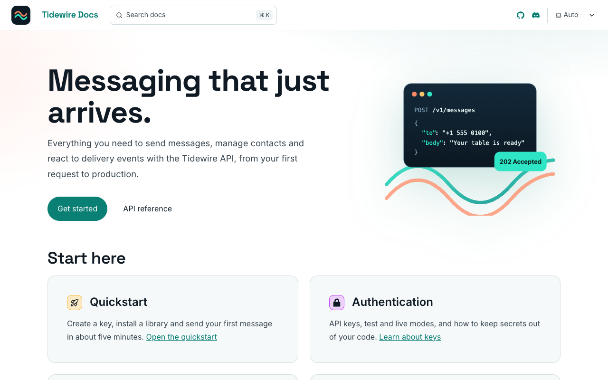

# Tidewire: developer documentation template

A fast, static docs site for APIs and developer products, built with Astro Starlight: guides, an API reference with multi-language code samples, built-in search and an `llms.txt` for AI tools.



[](https://console.cloudzyro.com/new?repo=https://github.com/Cloudzyro/template-docs)

## What's included

- Landing page with a hero, quick links and popular guides
- Sidebar with grouped sections (Getting started, Guides, API reference, Resources), built from your folders
- Built-in full-text search (Pagefind), no outside service
- Getting-started guide with numbered steps and package manager tabs
- API reference pages with endpoint labels, parameter tables, responses and code samples in cURL, JavaScript, Python and Go (tabs that remember the reader's language across pages)
- Callouts for notes, tips, cautions and warnings
- Versioning page, an API version badge in the sidebar and a version banner on reference pages
- `llms.txt` at the site root, generated from your pages at build
- Sitemap, `robots.txt`, Open Graph tags and a custom 404 page
- Custom theme (deep sea ink, aqua and coral) for dark and light mode, with Space Grotesk, Inter and JetBrains Mono self-hosted
- Fully static output (`dist/`), so it runs on any static host

## Run it locally

```bash
pnpm install
pnpm dev        # http://localhost:4321
pnpm build      # static site in dist/
pnpm preview    # serve the built site
```

## Make it yours

- **Site name, address, description, API version and social links:** `site.config.mjs`
- **Pages:** Markdown and MDX files in `src/content/docs/`. Each folder is a sidebar group; set `sidebar.order` in a page's frontmatter to change its position. Sidebar groups and their labels are in `astro.config.mjs`.
- **Landing page:** `src/content/docs/index.mdx`, with the illustration in `src/assets/hero.svg`.
- **Colors and fonts:** `src/styles/theme.css`. The `:root` block is dark mode and `:root[data-theme="light"]` is light mode. The accent is `--sl-color-accent`.
- **Logo and favicon:** `src/assets/logo.svg` and `public/favicon.svg`.
- **Social card:** replace `public/og-image.png` (1200x630).
- **Interface text** (such as the search label): `src/content/i18n/en.json`.
- **llms.txt:** generated by `src/pages/llms.txt.ts`. New pages appear in it automatically.
- **Older API versions:** see the Versioning page for how to publish docs for more than one version.

Set `SITE_URL` to your public address (for example `https://docs.yourcompany.com`) when you build, so the sitemap, social card and `llms.txt` use full addresses. This site has no forms and needs no other settings.

## Deploy

Click the **Deploy to Cloudzyro** button above, or push your own copy to GitHub and connect it in the Cloudzyro console. The build command is `pnpm build` and the output folder is `dist`. No server is needed.

## Stack

- [Astro](https://astro.build) 7 and [Starlight](https://starlight.astro.build)
- [Pagefind](https://pagefind.app) search (built into Starlight)
- [Expressive Code](https://expressive-code.com) for code blocks
- TypeScript

## License

MIT, see [LICENSE](./LICENSE).
